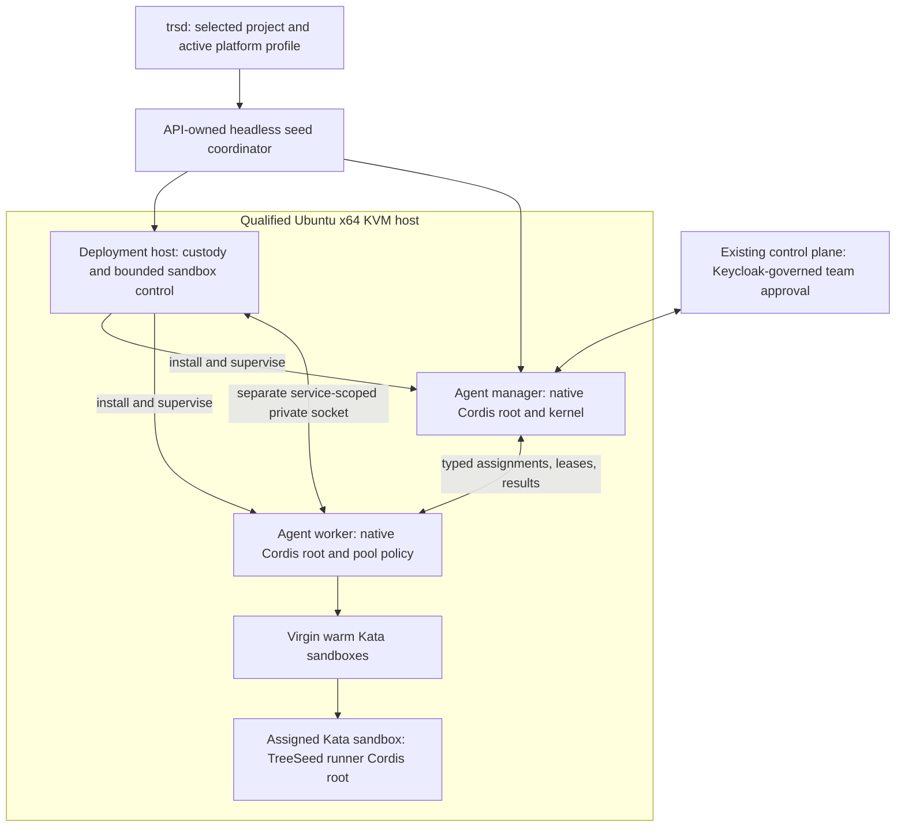

# Agent Capacity Provider architecture

Status: maintainer-approved Task 3D architecture, implementation in progress under
[Platform #773](https://github.com/treeseed-ai/platform/issues/773). This is the durable
architecture reference; the [delivery plan](superpowers/plans/2026-10-27-agent-composition.md)
records execution and verification. Approval of a design is not implementation evidence.

## Purpose and service boundaries

The Agent package is a Capacity Provider: a host-installed TreeSeed battery that supplies
execution capacity to one or more explicitly authorized teams. Its manager, worker and Kata
workloads are separate services on one qualified host. Deployment installs and supervises
them; it does not host the Agent root inside its own durable worker.

Each process has its own native Cordis root; execution children use native effects and leased
providers. Contexts do not cross processes and are not a security sandbox. The SDK locator is
a typed facade over Cordis resolution, never another resolver, service cache or scheduler.

The manager resolves exact definitions/profiles, validates live authority, prepares assignments,
coordinates dependencies and reports results. The worker owns admission, clean warm capacity,
exclusive assignment leases, replenishment, runner dispatch, cancellation and quarantine.
Deployment owns bounded runtime operations and infrastructure custody. Its existing observer
socket remains read-only; mutating sandbox control requires a distinct service-specific grant.

## Package and capability ownership

| Package | Owned capabilities and interfaces |
| --- | --- |
| SDK | Portable seed/capacity/definition/profile/environment/lease/acknowledgement schemas, projections, safe errors and public client contracts. |
| Agent | Manager/kernel, worker/pool policy, definition resolution, activity-profile providers, team connection, live grant checks, worker client, runner, environment preparation, execution, handlers, tools, context and reporting. |
| Agent | Manager/worker `container.service` class plugins and matching readiness providers; Dockerized services are plugins too. |
| Deployment | Common NPM/Git acquisition and immutable staging, target admission/read-back, service supervision, private filesystem primitives, host qualification and bounded Kata/containerd adapter. |
| API | Seed coordinator and reconciliation semantics; existing-team authority is consumed through public control-plane APIs. |
| Identity | Keycloak identity and authorization integration; existing approval and provider-credential protocols retain their identity. |
| CLI | Project/profile defaults, commands, public owner clients and view-model mapping. |
| UI | Reusable terminal/browser/server presentation providers and components; mobile-first rendering remains mandatory. |
| Admin | Existing application composition and identity custody; no additional browser application in this slice. |
| Platform | This reference, portfolio plans, exact composition declarations and assembled acceptance; no owner runtime source. |

Every meaningful seam has a typed contract and native class provider, or a documented coherent
invariant. The kernel's authorization, lease fencing and result-custody invariants cannot be
bypassed through provider selection. Metadata catalogues describe providers; native injection
supplies their instances. Advertised substitutions share a contract suite.

The current draft exports seven probe plugins from `@treeseed-cordis/agent`:
`AgentFileGrantPlugin` (`agent.authority`), `AgentContextPlugin` (`agent.context`),
`AgentEchoToolPlugin` (`agent.tool`), `AgentEchoHandlerPlugin` (`agent.handler`),
`AgentReporterPlugin` (`agent.reporting`), `AgentExecutionPlugin` (`agent.execution`) and
`AgentHostPlugin` (`agent.host`). These are draft composition infrastructure, not implemented
manager/worker/Kata capabilities. New capability metadata must be generated from the same class
declarations used for native `provide`/`inject`; update this map with verified exports.

## Definitions and extensible activity profiles

An activity-profile capability supplies a namespaced type identifier, versioned parameter
schema, compatible handler requirements and orchestration semantics. A profile instance belongs
to an Agent definition: its prompt, dependencies, parameters and requested permissions are data.
The manager produces an effective profile from exact revisions and the intersection of requested
permissions with live grants. A plugin cannot expand authority.

Core profile registrations cover planning, estimating, acting, reviewing, reporting and chat.
They are not a schema enum that excludes new types. Productive handlers for those activities
remain Task 10. Missing handlers block; a probe fixture must never be presented as real planning
or model execution. External packages can add profile types and handlers without core edits.

Before dispatch, reject unknown types, ambiguous/missing providers, incompatible handler/profile
versions, invalid parameters, missing dependencies and cycles. Pin the definition, profile,
handler, environment, artifact and grant revisions for the full execution lifetime.

Three profile concepts remain distinct:

| Concept | Selection |
| --- | --- |
| Platform profile | Local project/installation composition selected by explicit CLI flag, project active profile, then configured project default. |
| Activity profile | Definition-owned activity behavior selected and orchestrated by the kernel. |
| Execution environment profile | Sandbox image, dependencies, resources, setup and network requirements. |

## Execution and warm capacity

Readable orchestration follows resolve composition → acquire worker session → prepare environment
→ verify → run selected execution/handler → collect → close and verify. Use small, cohesive
TypeScript classes and at most twenty formatted body lines per new/changed method unless an exact
exception is reviewed. Preserve contextual refactoring and development-only enforcement.

Pool compatibility binds runtime qualification, base image digest, resource shape, isolation
policy and relevant worker/pool/sandbox/environment generations. Only credential-free,
never-assigned sandboxes enter the pool. Claims remove a sandbox before an await can admit a
second assignment. Replenishment happens in the background under native effects and configured
capacity bounds. Used sandboxes are destroyed and verified, not returned to the virgin pool.

Revocation/cancellation closes admission and prevents further effects/results. Failed cleanup
quarantines resources, fences readiness and returns recovery-required. A completed result requires
verified teardown. On restart, recover owned records and inspect actual resources before adopting
anything; uncertainty requires repair, never silent adoption.

Affected generation changes drain and discard unused old bases. In-flight work retains its leases
through destruction. No cross-generation reuse is qualified initially. Worker/sandbox transitions
require explicit restart unless an exact transition passes admission/drain/fencing/native disposal
and generation read-back. A self-declared live flag is not qualification evidence.

## Dependency preparation and runtime qualification

Environment packages declare immutable setup and verification entrypoints associated with an Agent
definition. Packaging resolves naming defaults into explicit manifest entries and hashes. Stable
dependencies use pinned images/archives; assignment-specific setup runs inside the claimed sandbox
before its handler. Bound time, output, cancellation, permissions and environment identity.

Setup is offline by default. Declared destinations require both host policy and assignment grants;
unlisted egress is denied. Materialized dependencies and setup results are bound to the execution
receipt. No ambient package script runs in the live host installation, and no credential is placed
in a virgin warm base. Setup failure prevents handler admission.

TreeSeed's workload startup sequence is separate from Kata guest-agent hooks. Kata's hooks live
in the guest rootfs and run in the guest-agent namespace; they are not per-plugin application
dependency setup. See [Kata 4.1 hook handling](https://github.com/kata-containers/kata-containers/blob/4.1.0/docs/design/hooks-handling.md).

Initially qualify Ubuntu 26.04 x64, KVM, required runtime access and exact Kata/containerd/image
artifacts. The existing Kata 4.1.0 inventory is a source candidate, not qualification by itself.
Never substitute an ordinary container when isolation is unavailable. Reuse approved runtime
artifacts without overwriting global daemon configuration or touching legacy brokers/services.
Runtime namespaces support ownership bookkeeping; they are not a security boundary.

The Agent worker receives only its bounded service-scoped sandbox-control endpoint. Deployment's
host identity must already have explicit runtime authority; missing privileges are a blocker.
Named grants and socket mounts extend the service contract deliberately; arbitrary host paths,
raw engine sockets and privileged options remain forbidden.

## Human and machine interfaces

`trsd seeds validate|plan|apply|show|verify` drives the [seed lifecycle](seed-architecture.md).
Capacity diagnostics, status and harmless probe commands use public owner clients. Existing
platform commands and seven global operation IDs remain compatible; new owner protocols are
separately versioned. Human output uses UI-owned terminal providers; machine envelopes use SDK
schemas and safe errors. This slice adds no browser application.

Project selection is explicit `--project`, then the configured default project. Profile selection
is explicit `--profile`, the selected project's active profile, then its configured default.
An invalid/missing selection fails rather than choosing another account or installation. Secrets
are references, not seed contents or command output.

Manager/worker and sandbox control protocols carry installation/provider/scope, request/lease,
generation and exact grant identity. Private local transports remain owner/service-bound. Guest
protocols expose only the assignment's bounded capabilities, never host management access.

Real team connections use the existing control plane's public team/enrollment APIs through a
swappable adapter. Consume owner-approved enrollment references and preserve Keycloak-governed
approval plus the signed provider-credential exchange. Bind issuer, subject, team, provider and
grant revisions explicitly. Do not create teams, migrate accounts or authorize from request-field
equality. Heartbeat/readiness expires honestly; revoked/expired authority fails closed. Tests use
isolated control-plane fixtures and real isolated Keycloak, never production enrollment.

## Current implementation and acceptance ledger

| Capability | Current status |
| --- | --- |
| Agent Cordis setup | Reviewed and published. Do not initialize again. |
| Bounded SDK probe contracts | Implemented candidate [SDK #483](https://github.com/treeseed-ai/sdk/pull/483), not merged. |
| Agent native probe root/children | Existing unmerged draft; refactoring and additional qualification required. |
| Separate manager/worker/guest roots | Approved requirement; implementation pending. |
| Real warm Kata pool and setup | Approved requirement; implementation pending. |
| Extensible activity-profile bindings | Approved requirement; implementation pending. |
| Real existing-team adapter | Approved requirement; implementation pending. |
| Seeds and installed target integration | Approved requirement; implementation pending. |
| Real Work/model execution/accounting | Deferred to Task 10. |

Completion requires owner checks/build/all applicable test tiers, actual built programs, genuine
NPM/pinned-Git substitution, real Kata setup/exclusive claim/refill/destruction, Keycloak/connection
contract evidence and exact assembled archives. Permanent tests use behavior names in the four
tests tiers. No task-numbered permanent specifications.

Real Kata acceptance requires an isolated self-hosted Ubuntu 26.04 x64 runner labelled
`cordis-kata`. Provisioning is outstanding; do not register the workstation implicitly. Hosted
checks remain useful but cannot substitute for this gate. All issues remain open; review handoff
does not authorize merges, production release or cutover.
