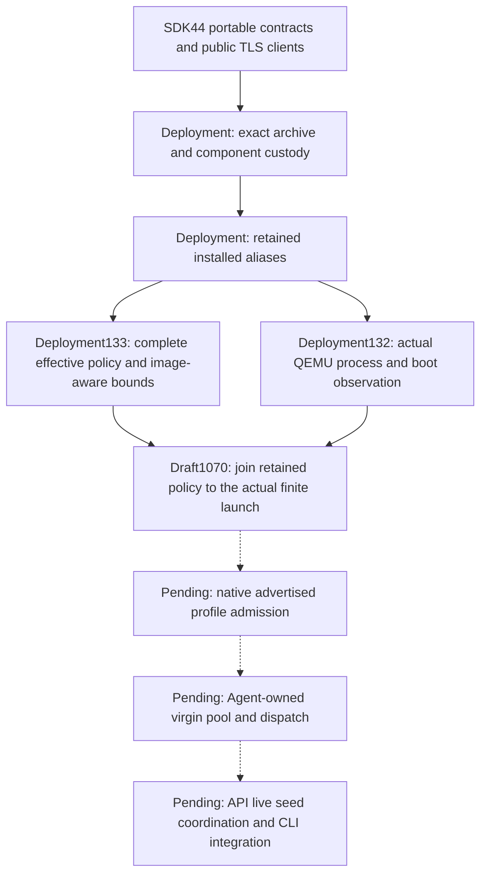

# Runtime custody and installed capacity evidence

This is an owner-evidence reference for [the Agent architecture](agent-architecture.md) and
[seed architecture](seed-architecture.md). It records independent accepted capabilities, not a
completed installed Capacity Provider or a newly assembled release lock. All issues remain open;
productive Work/model execution and accounting remain Task10.

## Composition and admission boundaries

The archive/component/alias/policy stages verify real bytes and retained filesystem identities.
Boot observation binds actual process generation, command identity and selected boot inputs.
Neither stage alone establishes that an owned VM used the complete retained policy. The joined
launch candidate must pass fresh hosted positive verification before it can support native profile
admission. A profile then needs actual owner/worker integration; it cannot replace leases, live
authority, pool ownership or service readiness.

Every privileged operation remains behind Deployment's bounded service boundary. Cordis roots
compose separate manager, worker and guest processes; they do not cross process boundaries or
provide an OS sandbox. Agent retains kernel, handler/profile, pool and environment ownership.
API retains seed coordination and existing-team authority through its public control plane.
UI retains reusable mobile-first React/Cordis presentation, and Identity retains Keycloak identity.

## Accepted owner identities

These are exact independent owner candidates. Producer commits identify the frozen packaged bytes;
accepted PRs record their complete owner checks, public consumers and hosted evidence.

| Owner candidate | Producer source | Archive SHA256 | Accepted evidence |
| --- | --- | --- | --- |
| SDK44 | `00be028b92998f8d7039a3906e784c6b8598e730` | `d95c54cf6081c7634498dfb4f3235d42d65b8664a5d62cc87c4dd4e85381f0f3` | [SDK508](https://github.com/treeseed-ai/sdk/pull/508) |
| Deployment133 | `7d2fdf605e6c8aabe6e75276300bbc331d7bd2d7` | `beb76d0896f4c0b856214b0429d3e959300454db20a139b940ab22d6a9a4ac0c` | [Deployment1068](https://github.com/treeseed-ai/deployment/pull/1068) |
| Agent35 | `4404149276af9b35cedf88aea0e67c8bcf982030` | `a4a8609e8d427337a0e1470fac3b397a591b741105f6f958a94ad2a2d228d341` | [Agent562](https://github.com/treeseed-ai/agent/pull/562) |
| API16 | `9fb1af1e52370120d561f897d804c16ba85db091` | `44b5e4d6dcb9bae08e089d84516eea268edaacecf0ff2f16f51e2cdbf45dede0` | [API658](https://github.com/treeseed-ai/api/pull/658) |

Agent35 still selects Deployment127, while API16 selects Deployment130. They must not be presented
as an assembled closure using Deployment133. Update consumers through exact public archives and
fresh owner/assembled verification before making that claim. UI24, Identity10 and Admin13 are
accepted compatible owner candidates through [UI108](https://github.com/treeseed-ai/ui/pull/108),
[Identity61](https://github.com/treeseed-ai/identity/pull/61) and
[Admin154](https://github.com/treeseed-ai/admin/pull/154). Their acceptance preserves React reuse,
mobile-to-widescreen behavior and Keycloak identity; it does not implement Agent UI or activation.

The frozen earlier assembled evidence remains immutable historical evidence. In particular,
Platform817's SDK39/Deployment95/Agent21 selection is not a current installed manager/worker/pool
proof. Do not repack, relabel or rewrite those artifacts or their acceptance expectations.

## What the current evidence proves

- Deployment133 has complete template-policy comparison, private descriptor custody, exact installed
  alias checks, real QEMU boot observation and bounded root-image address-space interpretation.
  Both complete owner closures passed, including102 foundation cases each. The new finite policy
  has not yet been joined to a running VM by an accepted owner candidate.
- Agent35 has separate built manager/worker/guest programs and twenty native provider descriptions.
  Both139-case owner acceptance runs included genuine worker/Kata readiness. Default manager/worker
  diagnostics remain unready. The frozen guest channel is readiness-only; run/cancel and productive
  handlers are not established by that result.
- API16 includes API-owned native seed-journal semantics over Deployment's private installation
  records, with public default construction and isolated real Keycloak/browser verification.
  A journal is not the seed coordinator, team-management authority or resource reconciliation.
- SDK44 has exact portable contracts and real TLS availability create/refresh/close transport.
  A transport or registration-status response is not approval, a live grant or manager orchestration.
  The seven global platform operation IDs remain unchanged.

## Draft native launch binding

[Deployment1070](https://github.com/treeseed-ai/deployment/pull/1070) is a review candidate for
`KataLaunchAttestation`. Its frozen134 producer is
`8c4e95714d32c1a40d13dcbe4a8a94266446432c`, archive SHA256
`34130ebddc71b24844b104b68be7efc6904441faff4c91ca1beece6ef0d15f19`.
The fixture-only corrected head is `9ebfc0331d8fe5d1b86322260aed5f31555ef380`;
all176 packaged files/modes remain identical, with no repack. Fresh corrected-head hosted finite
launch, valid mismatched-policy denial and destruction invalidation remain required. A previous
fixture stopped before launch at invalid sandbox-ID admission and cannot count as VM evidence.

Owner references: [effective policy](https://github.com/treeseed-ai/deployment/blob/0e88b49b8957772110bb26271dcd4e86a1f439e9/docs/runtime-policy-custody.md),
[installed aliases](https://github.com/treeseed-ai/deployment/blob/0e88b49b8957772110bb26271dcd4e86a1f439e9/docs/runtime-alias-custody.md),
[guest artifact boundary](https://github.com/treeseed-ai/deployment/blob/0e88b49b8957772110bb26271dcd4e86a1f439e9/docs/kata-guest-runtime.md),
and [candidate launch contract](https://github.com/treeseed-ai/deployment/blob/9ebfc0331d8fe5d1b86322260aed5f31555ef380/docs/kata-launch-binding.md).

## Remaining delivery gates

Native profile publication and installed named host grants/socket mounts remain required before
Agent can admit a qualified virgin pool. Then prove exclusive claims, background replenishment,
generation discard, setup/verification/egress, real runner dispatch/cancellation and verified
one-use destruction. Preserve manager lease fencing, live existing-team enrollment/heartbeat/
revocation, exact Keycloak authority and cross-team denial. Complete the API coordinator/resource
owners, CLI seed/capacity and project/profile selection, exact final assembly and qualified Agent
replacement transitions. General replacement expansion remains Task4; productive Work/models and
accounting remain Task10. Integration into cordis neither closes issues nor authorizes production
publication or cutover.
