# Seeds: the TreeSeed integration architecture

Status: maintainer-approved Task 3D foundation; native journal custody is integrated, while live
coordination and installed resource reconciliation remain pending under
[Platform #773](https://github.com/treeseed-ai/platform/issues/773). See the
[Agent architecture](agent-architecture.md) for capacity services and the
[delivery plan](superpowers/plans/2026-10-27-agent-composition.md) for execution evidence.

## Intent and ownership

See [current runtime and journal evidence](runtime-custody-evidence.md): API .16 includes the
headless native journal, not a completed default seed coordinator or live team authority.

A seed is an immutable, versioned collection of TreeSeed resources and capability requirements.
It is the integration mechanism across the platform: a seed expresses what should exist, native
Cordis plugins provide the behavior, and each owning package reconciles its resources through its
public boundary. A seed is declarative data, not an ambient install script or another plugin
framework. Future domain resources extend this same mechanism rather than inventing installers.

SDK owns portable SeedBundle/SeedPlan/SeedReceipt schemas, inferred types, client contracts and
generated projections. API owns the coordinator, reconciliation semantics and canonical seed
journal abstraction, preserving the legacy API's ownership of seed operations. CLI consumes an
isolated headless API package export without starting its server. Deployment owns acquisition,
private filesystem custody and installation operations; Agent owns its definitions, profiles,
environment and capacity resource providers. Platform owns composition declarations and assembled
evidence, never seed runtime source.

The initial slice covers host composition, exact plugin selection, capacity-provider configuration,
Agent definitions and environments. Activity-profile instances belong inside Agent definitions;
profile types are plugin capabilities. Production teams/memberships/projects/repositories and real
Work/model migration stay with their later owner-domain tasks. Existing seed v3 contracts/receipts
retain provenance; new host resource contracts are explicitly versioned and are not silently
treated as compatible legacy payloads.

## Contracts and provider discovery

SeedBundle identifies a seed/revision/digest, resource identities/schema references, dependency
edges, capability requirements and package sources. Planning resolves sources to exact package
versions/archives or HTTPS Git commits with closure hashes. SeedPlan binds those artifacts and
validator executables, schemas, selected project/profile/installation, authorization, owner
preconditions and intended effects. SeedReceipt links per-resource and per-target owner receipts,
their verified identities and truthful aggregate state.

Resource kinds are namespaced, versioned provider capabilities, not a permanently closed enum.
Unknown kinds block until an accepted compatible provider is prepared. Metadata describes resource
schemas and required capabilities; provider classes declare native provide/inject bindings. A
typed locator resolves actual instances. There is no seed service cache or parallel resolver.

The trusted bootstrap consists of the exact CLI/API headless coordinator, SDK envelope contracts
and Deployment's common verifier/package manager. Seed resource packages cannot bootstrap their
own trust or grant authority. Selected implementations and permissions remain explicit.

## Validate, prepare, plan, apply and verify

```mermaid
flowchart LR
  Envelope[Parse core envelope] --> Closure[Resolve and verify exact closure]
  Closure --> Prepare[Restricted validator preparation]
  Prepare --> Validate[Validate resources and dependency graph]
  Validate --> Plan[Save exact non-activating plan]
  Plan --> Recheck[Recheck grants and owner preconditions]
  Recheck --> Reconcile[Policy-admitted install and owner reconciliation]
  Reconcile --> Readback[Verify owner receipts and readiness]
```

Validation rejects malformed/duplicate-key inputs, unsupported schemas, duplicate resource
identities, missing dependencies, cycles and incompatible/ambiguous capabilities. A seed cannot
request more authority than its owner/project/team grants.

Resolve and verify package closures before executing resource-provider code. Acquisition/build
uses the common accepted-artifact path; ambient lifecycle scripts never run in the live install.
Prepare accepted executable validators in an isolated, restricted planning process/container with
read-only planning ports, no writable live installation and no host-control/credential access.
Cordis composition itself supplies no isolation. Bind executable/schema identities into the plan.

Seed planning may create/destroy disposable preparation containers for validators. It does not
start managed Agent services, assign workloads, activate providers or mutate live resources.
The existing Task 2 `platform plan` non-activation guarantees remain unchanged.

Apply revalidates exact artifacts, authority and owner preconditions before each mutation. Missing
capabilities may be installed and activated when existing policy/grants and exact transition
qualification permit. Otherwise report blocked, prepared, pending or recovery-required with the
required action; never treat a downloaded or registered package as active. Do not re-resolve tags
or choose a different account/provider on retry. Restart/migration actions remain explicit.

Read-back verifies each owner's record and current runtime acknowledgement. A stale persisted
active record after process restart is not readiness. Seeds reserve no runtime capacity; workers
admit assignments separately. A completed harmless probe is not real Work/model acceptance.

## Durable custody, partial progress and recovery

There is one canonical seed journal per selected installation under owner-private `.cordis/seeds`.
API owns its semantics; a Deployment public custody adapter supplies descriptor-anchored,
no-symlink ownership/permission/atomic-publication primitives. CLI and future API invocation use
the same authority and journal rather than keeping independent copies.

Resource owners retain their own durable records. The seed journal links exact plans, idempotency
keys, owner records and verified read-back. Single-writer serialization and no-overwrite publication
prevent concurrent or interrupted invocations from silently adopting uncertain state. Records are
private; tokens/credentials are referenced and never copied into the bundle, receipt or output.

A successful plugin installation followed by failed resource reconciliation is partial progress,
not transaction rollback or seed success. Resume only verified completed steps, recheck authority
and outstanding preconditions, and reconcile remaining steps with the same exact artifacts.
Lost replies require read-back by exact identity. Uncertain effects require recovery; never execute
destructive automatic rollback or imply cross-owner atomicity.

## Operator interfaces and defaults

`trsd seeds validate|plan|apply|show|verify` consumes SDK machine envelopes and UI-owned terminal
rendering. Apply uses the saved plan identity/digest and an idempotency key. Capacity diagnostics,
status and probe commands consume Agent/Deployment public interfaces. Plugin installation shares
the existing common manager; seed requirements do not introduce another registry.

Project selection is explicit `--project`, then configured default project. Profile selection is
explicit `--profile`, project active profile, then project default profile. Missing/invalid values
block; no implicit account, credential or installation fallback. Platform configuration profiles
are distinct from Agent activity profiles and execution-environment profiles.

Team prerequisites resolve through the existing control plane's public API adapter and its live
authority. Seeds consume approved enrollment references; they cannot approve their own team
membership or grants. Keep exact Keycloak issuer/subject and signed provider-credential identity.
No production/legacy endpoint is called by automated acceptance fixtures.

## Verification and extension contract

Each resource-provider implementation shares its contract suite and has default production
construction coverage. Built CLI acceptance proves planning, policy-qualified missing-plugin
installation, exact owner reconciliation, read-back, repeat and recovery from partial progress.
Cover missing kinds, incompatible schemas, tampered archives/metadata, dependency cycles, denied
authority, concurrent writers, lost replies and stale readiness.

Use genuine prepared archives and pinned HTTPS Git fixtures. Fixture resource kinds and harmless
handlers are identified as fixtures; no claims of migrated domain behavior. Keep permanent tests
under their four capability-named tiers and immutable historical pins unchanged. Completion also
requires owner CI and the real Kata/Keycloak assembled acceptance recorded by the delivery plan.
