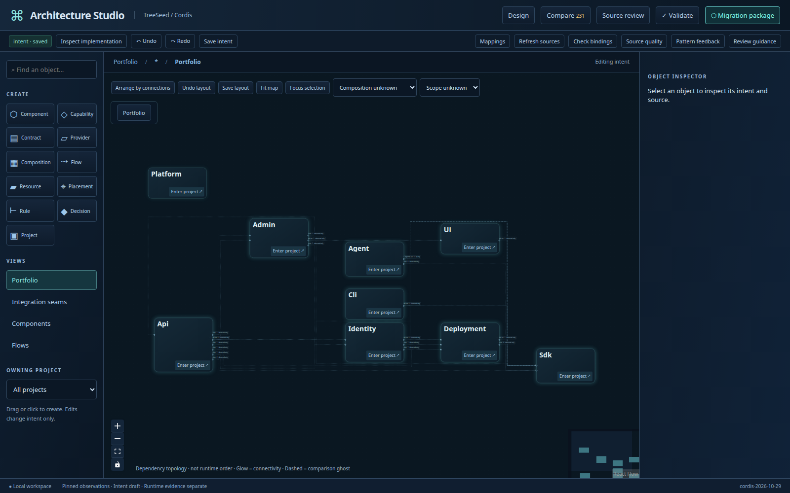
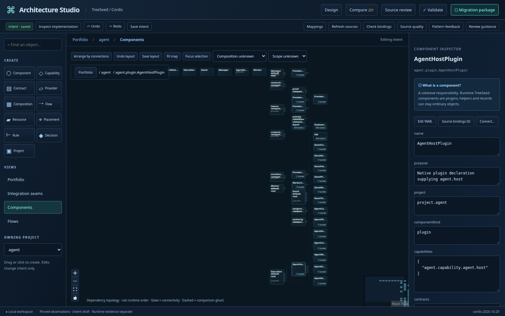
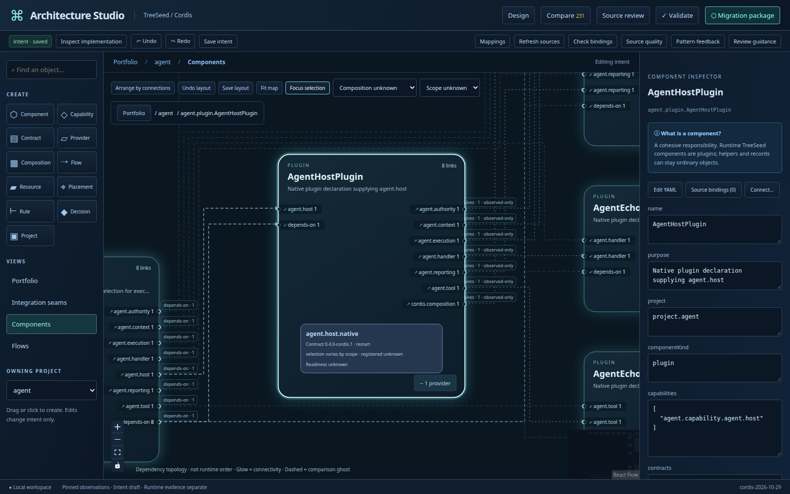
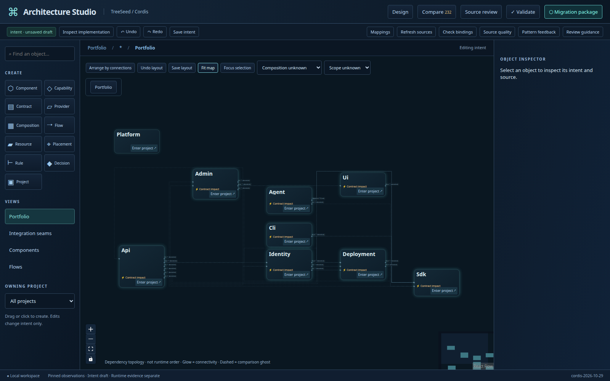

# Digital cells verification

The built Studio was exercised against a disposable copy of the actual nine-project
workspace. Screenshots are observations of the UI, not runtime conformance evidence.
The contract-impact image uses an unsaved, illustrative purpose change to the SDK
Cordis composition contract in that disposable workspace.

- `npm run check`: strict TypeScript, class architecture and shared canonical
  readability check passed; no baseline/exception additions.
- `npm run build`: frontend, layout worker and local companion built successfully.
- `npm test`: 23 unit, 7 integration and 3 built-browser acceptance cases passed.
  Studio's regression tier is explicitly empty.
- Shared test-layout/discovery check passed, including the CI specification inventory.
- Browser: project seam → original Agent plugin → nested provider → SDK; search
  reveals the SDK contract; editing its intent highlights cross-project impact.
- Browser: overview → Agent → expansion → overview → Agent restores expansion;
  keyboard movement and dragging → arrange → undo → layout save → reload preserve
  architecture document bytes.
- Browser: existing create/connect/undo/redo/save/migration workflow passed.
- Integration: layout 0.2 publication rejects stale hashes and leaves blueprints
  unchanged; existing interrupted-save and path-escape cases still pass.
- Geometry: repeated ELK requests agree; routes attach to exact ports, remain
  orthogonal, and avoid unrelated cell interiors in the cycle/disconnected fixture.
  A reversed-grid fixture has fewer proper crossings after automatic layout.
- UI was exercised at 1600×1000 and 1100×800 with reduced motion requested.

## Interpretation and limits

Provider selection requires composition and scope. The baseline does not supply
runtime readiness evidence, so provider cards say unknown. A structural edge does
not establish runtime sequencing. Observed-only edges are not deletion requirements;
omitted intent remains unspecified. Explicit normative field changes can show
removed connections. Shared geometry uses the union of implementation and intent.

Manual placement can create overlaps. Dragging preserves orthogonal endpoint
attachments to the last routed path; **Arrange by connections** recomputes complete
obstacle-aware routes. Font measurements are bounded to 680px; longer names remain
available through titles and the inspector. Large maps require zoom or drill-in.
No guarantee is made that an arbitrary graph has a crossing-free drawing.

## Images

