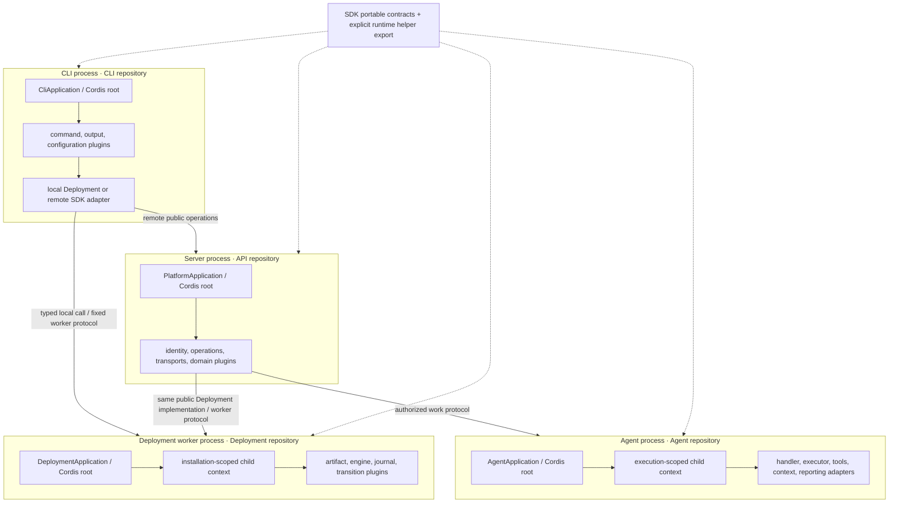
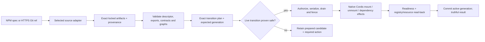

# Required Cordis composition and provider plugins

Date: 2026-10-24. Status: **maintainer-approved architecture; Task 3A only explicitly resumed on 2026-10-24**. Later slices and new-owner setup retain their own authority/review gates. Tracking: [Platform #704](https://github.com/treeseed-ai/platform/issues/704). Read with the [platform contract](../../platform-contract.md) and [delivery plan](../plans/2026-10-24-cordis-composition-providers.md).

## Intent and current evidence

Cordis is the required composition foundation across CLI, API, Deployment and Agent, and at application-level extension seams introduced elsewhere. Its role is broader than HTTP exposure. A product capability is a typed contract, one or more registered class-based provider adapters and an explicit selection in a Cordis scope. New capabilities and providers can arrive in independently built NPM packages or Git repositories through `trsd plugin install <source>`.

The maintainer chose **install and activate when safe**, rather than prepare-only by default. Live replacement is a core acceptance requirement. A verified live transition is preferred; restart, process replacement or migration remains an explicit alternative when live replacement cannot preserve the capability's invariants. Unknown safety must never be called hot-swappable.

Tasks 1–2 are merged and retain their evidence: help/version/doctor, exact local bundle planning, private plan publication/read-back and seven executable operation contracts. Their classes use direct constructor injection; they do not execute a Cordis context. Plugin fixtures validate declarations without loading them. No claim in this design converts that work into implemented Cordis composition, installation, provider switching or remote APIs.

This design supersedes the earlier API-only composition emphasis, prepare-only plugin acquisition, blanket restart-first activation policy and exclusion of the bounded plugin installer. It does not authorize implementation, a marketplace, arbitrary execution hooks, production publication or changes to legacy installations.

## Composition rules

1. Every first-party runtime application owns a native Cordis root: CLI, API server, Deployment worker and Agent host. Long-lived child scopes follow actual session, installation or execution lifetimes. A CLI invocation also has a root, even though it is short-lived.
2. Capabilities consumed at a pluggable seam use an interface/abstract-class contract and selected class adapter. The composition root mounts providers; consumers declare Cordis dependencies and use typed services. Production consumers must not silently instantiate concrete providers or maintain static provider-ID switches.
3. A `ServiceLocator` adapter is required as the typed selection/inspection facade over Cordis. Cordis remains the sole in-process service resolver, dependency graph and plugin/effect lifecycle. Our facade adds exact provider identities, validated configuration, selection policy and observable generation receipts; it must not own a second instance cache, DI graph or custom start/stop scheduler.
4. A plugin is a lifecycle-managed unit, including mandatory core capabilities. A provider is a plugin-supplied implementation of a capability. An adapter implements the typed boundary to a library, protocol or resource. These roles can occupy one class/package; do not manufacture three wrapper layers.
5. Multiple providers may be installed and registered. Exactly one is selected for a required singleton capability in each scope. Alternatives inhabit native isolated scopes until selected; ordinary duplicate publication in one scope is an error. Multi-provider aggregation is allowed only by an explicit collection contract, never by registration order.
6. SDK schemas/data records and pure utility classes need not create contexts. UI composition participates where components/actions are registered; no context per button or data record. Third-party internals are not rewritten. TreeDX retains Elixir/Rust and is consumed through a typed public adapter.
7. All handwritten implementation, tooling and tests remain strict TypeScript classes. Native Cordis effects own listeners, timers, registrations and child lifetimes. Durable work and external resources also require explicit owner drain/fence/recovery evidence.

## Context and process map

Every box below is proposed. Contexts do not cross a process boundary or provide a security sandbox.



| Context | Owner / proposed class | Mounted capabilities and lifetime | Boundary |
| --- | --- | --- | --- |
| CLI root | CLI `CliApplication` | Bundled command/configuration/output plugins and approved installed CLI contributions; one invocation, including final disposal | Works before API startup; help/version do not contact Docker or mutate state |
| Local Deployment child | Deployment `DeploymentPlugin`, mounted by CLI | Selected `DeploymentHost`, artifact verifier, engine and private-state adapters; invocation lifetime | CLI uses a public package; no duplicate lifecycle implementation |
| Deployment root and installation child | Deployment `DeploymentApplication` | Fixed worker protocol, installation ownership, engine adapter and journal; accepted application lifetime survives client/server exit | Never an arbitrary package-controlled privileged command runner |
| API root | API `PlatformApplication` | Identity, operation invocation, REST/MCP transports, Deployment adapter and feature plugins; process lifetime | API owns hosting, not other repositories' capabilities |
| API authorized request scope | API, with Identity-owned principal integration | Trusted principal/resource context and leases for selected services; request lifetime | Cancellation does not erase accepted durable work |
| Agent root / execution child | Agent `AgentApplication` | Registered handlers, execution provider, tools/context/reporting; root and accepted-execution lifetimes | Work authority stays API-owned; isolation and credential boundaries are separate from Cordis |
| Admin server / browser composition | Admin, UI support | Server-side session/actions; separately built browser page/navigation/component contributions | No server plugins or credentials in browser bytes; no arbitrary runtime remote browser modules |

CLI-local Deployment and worker roots consume the same owner package and contracts. They do not run competing lifecycle writers: the accepted host application is owned by the worker; local calls submit or inspect it through its fixed protocol. Short-lived diagnostic/planning contexts remain non-activating.

## Packages, plugins and authority

Only the first three package names below exist today. Proposed subpath exports are design contracts; other owners' public NPM names remain unallocated. A row is a module/export inside its existing repository, not a request for a new repository.

| Repository / package | Proposed entrypoints or plugins | Owns | Does not own |
| --- | --- | --- | --- |
| Platform root | Composition manifests, exact artifact pins, assembled tests | Cross-project contract, integration and verification | Any application runtime, plugin implementation or provider database |
| SDK / `@treeseed-cordis/sdk` | Portable declarations; `./runtime` with `CordisComposition`, `CordisServiceLocator`, provider-binding helpers; `./source-policy` stays development-only | Shared registration/selection contracts and generic native-Cordis adapter mechanics | Domain adapters, installation authority, credentials or a second resolver |
| CLI / `@treeseed-cordis/cli` | `CliApplication`; core help/doctor/plan commands, `PluginCommands`, output/configuration plugins | Arguments, target selection and presentation; CLI capability contracts | Package acquisition internals or copied Deployment lifecycle |
| Deployment / `@treeseed-cordis/deployment` | `DeploymentPlugin`, `DeploymentApplication`, `PluginManager`, engine/source/build/private-store adapters | Acquisition, immutable package generations, durable plugin transactions, host lifecycle and recovery | User/session identity policy, Agent execution or API domain authority |
| API / `packages/api` | `PlatformApplication`, operation/REST/MCP/loader plugins; domain-owned providers | Server host and transport wiring; Projects/Work authority when introduced | Reimplementation of Deployment or Agent |
| Identity / `packages/identity` | `IdentityPlugin`, selected issuer/session/principal adapters | Identity protocols, principal mapping and capability authorization | A new homegrown token issuer or generic execution authority |
| Admin / `packages/admin` | Web/session/action/page plugins | Browser shell and server-side action/session facade | Domain authorization enforced only by UI |
| UI / `packages/ui` | Typed component/form contribution providers | Reusable class-based browser components and contribution contracts | Backend persistence or deployment policy |
| Agent / `packages/agent` | `AgentApplication`, handler/executor/tool/context/reporting plugins | Physical execution and its resource/usage/cleanup evidence | Durable work acceptance, authorization grants or settlement policy |
| Core / `packages/core` | Optional reader/site plugins | Existing public reader capability | Cordis application hosting |
| TreeDX / existing service | Existing protocols; consuming adapter stays with its capability owner | Existing repository/knowledge storage and service | A new Cordis rewrite or general API authority |
| External provider packages | Declared target exports and typed provider classes | One or more compatible capability implementations | Implicit authority to replace mandatory policy or bypass installation ownership |

SDK runtime helpers are imported explicitly; portable schema/client imports must not start a context or load Node-only runtime modules. Preserve existing licenses, notably the API's AGPL boundary; do not bundle API implementation into the Apache CLI merely to share composition helpers.

## Pluggable-seam decision and inventory

For each new capability ask: **can a caller retain its contract and invariants while another implementation supplies it?** If yes, define a typed selectable provider. If not, record the invariant that makes it one coherent system; do not create independently switchable pieces that break its transaction or authority. Owner issues must carry this seam decision and its contract suite before implementation.

| Seam | Contract / examples | Selection and replacement |
| --- | --- | --- |
| CLI command contribution | `CliCommand`; bundled and installed command plugins | Unique command path, same parsing/output contracts, invocation-pinned generation; cannot replace core management commands by collision |
| Configuration/output | Typed CLI configuration and rendering interfaces | Select at invocation boundary; machine envelopes remain mandatory |
| Local/remote platform access | Typed platform operation caller; local Deployment versus remote client | Explicit target, no silent remote fallback; transport cannot enlarge authority |
| Deployment engine | `DeploymentHost` / engine adapter; initial Compose implementation | Select per installation; live plugin changes do not imply live engine migration |
| Artifact sources and builds | `PluginSourceAdapter` for NPM/Git; `PluginBuildAdapter` for approved build recipes | Register through Cordis; preserve exact bytes and provenance; no raw live install hooks |
| Private storage | Typed journal/store adapter behind one durable protocol | Substitute only after ownership, atomicity, crash/replay and migration conformance; not live while a writer owns a transaction |
| Identity | Issuer/session/principal adapter | Pin issuer/audience/resource/grants; quiesce or restart when session compatibility is unproven |
| Operations/transports | Typed handlers, REST/MCP transport adapters, SDK transport | One executable operation binding; unregister collisions/effects; preserve schema and authorization |
| Domain persistence / repositories | Owner-defined interfaces to database/TreeDX/external APIs | Select resource and authority explicitly; data migration is a planned lifecycle action |
| Agent | Typed handler, executor, workspace/tool/context and reporting interfaces | Pin each accepted execution; active work drains or uses explicit cancellation/recovery; no mid-task provider substitution |
| Browser contributions | Typed page/navigation/component/action declarations | Build and activate matching asset generation; no server-side live swap can attest browser replacement without asset read-back |

Integrity verification, scope/authorization enforcement, exactly-one selection, lease/generation checks and durable commit/recovery semantics are mandatory rules of the integrated system. Their implementation may be modular and tested, but installed providers cannot disable those rules. Cryptographic primitives, simple data objects and every private helper are not independent plugin seams.

### Proposed registration and locator contracts

The following names/signatures are proposed, not current SDK exports. Concrete capability interfaces remain in their existing owner; SDK tokens refer to them through public types. Schema validation must check actual runtime shape/compatibility; a TypeScript generic alone is insufficient.

| Owner | Proposed contract | Meaning |
| --- | --- | --- |
| SDK portable | `CapabilityToken<T>` | Stable capability ID, contract version and executable adapter validation; no implementation instance |
| SDK portable | `ProviderRegistration<T>` | Plugin/provider IDs, target, token, config schema, supported contract/runtime, artifact identity and transition policy; class export reference from verified package |
| SDK portable | `ProviderSelection` | Scope ID, capability ID, provider ID, exact artifact/configuration digest, expected generation; server fills trusted authority separately |
| SDK runtime | `CordisComposition.start(descriptor, trustedContext): Promise<CompositionHandle>` | Mount validated class plugins through native Cordis; handle exposes scoped locator and awaited disposal |
| SDK runtime | `ServiceLocator.describe(token): ProviderDescription[]` | Inspect authorized registered candidates and selected/readiness/generation state; no secret material |
| SDK runtime | `ServiceLocator.acquire<T>(token: CapabilityToken<T>): Promise<ProviderLease<T>>` | Resolve the selected native Cordis service in this authorized scope; does not choose or instantiate another provider |
| SDK runtime | `ProviderLease<T>.value`, `.generation`, `.release(): Promise<void>` | Operation/execution pins one selected generation; scope/effects release on every exit path |
| Deployment public | `PluginManager.install(request: PluginInstallRequest, authority: InstallationAuthority): Promise<PluginInstallResult>` | Resolve/register and attempt safe activation through the same durable plan/apply authority |
| Deployment public | `PluginManager.select(request: ProviderSelection, authority: InstallationAuthority): Promise<PluginInstallResult>` | Change the selected provider; install alone cannot ambiguously choose among multiple advertised candidates |

Host mounting maps registrations to native Cordis plugin instances and isolated service names/scopes. Registration is accepted declarative metadata plus Cordis registration, not a parallel global singleton registry. Locator acquisition must require declared native injection; it cannot be an unrestricted `ctx.get` escape hatch. Consumers must not retain raw implementations outside their lease/dependent fiber. Owner adapters fence stale-generation use; test post-release and provider-removal calls. Generic lease bookkeeping is admission/drain accounting, not another DI lifecycle.

Selections bind implementation identity separately from an account/connection/credential grant. New code does not select a new account. Preserve legacy exact-grant reauthorization and terminal denial rather than trying another provider, tenant or credential. When multiple provider options are offered, retain an existing explicit selection; select a new singleton only if exactly one eligible option is explicitly enabled. Otherwise return `SELECTION_REQUIRED` with safe candidate identities. Updating the already-selected plugin/provider ID to new compatible bytes can activate automatically when safe. Installing a different provider ID does not override an existing explicit choice: retain it as a prepared registered alternative and require `plugin select` before claiming that provider is selected/active. Plugin inspection must distinguish registered alternatives from the selected ready provider.

## Plugin installation interface and artifact flow

Proposed human/machine commands, all unimplemented:

```text
trsd plugin install <NPM package|Git repo> [--installation ABSOLUTE_PATH] [--target cli|api|deployment|agent] [--idempotency-key KEY] [--json]
trsd plugin list [--installation ABSOLUTE_PATH] [--target TARGET] [--json]
trsd plugin inspect <plugin-id> [--installation ABSOLUTE_PATH] [--json]
trsd plugin select <capability-id> --provider PROVIDER_ID [--installation ABSOLUTE_PATH] [--target TARGET] [--idempotency-key KEY] [--json]
trsd plugin disable <plugin-id> [--installation ABSOLUTE_PATH] [--target TARGET] [--json]
trsd plugin remove <plugin-id> [--installation ABSOLUTE_PATH] [--target TARGET] [--json]
```

Install/select request schemas require an idempotency key. CLI `--idempotency-key KEY` lets automation and users retry the same intent after any lost reply. If omitted, the CLI creates a new key for that invocation; repeating bare command text is a new request and may resolve a changed tag. Before any source/network/build action, persist the key and canonical source/target/configuration intent in a private request receipt under the versioned journal. A repeated key returns/resumes its exact receipt/application; different intent with that key conflicts before resolving sources. Initial expected-generation selection is pinned in that receipt, not recomputed from current state on retry. Plugin list/inspect expose safe request identities and incomplete status so a human can recover an automatically generated key after losing output. Result includes `requestId` (the persisted key). The key is identity, not a secret or authorization grant.

The default installation is the existing CLI-selected local installation. This first installer does not add remote acquisition endpoints. If a descriptor supports exactly one target, that target can be inferred; a multi-target package requires `--target`. No package silently mounts into every process. Disable/remove preserve data, dependencies and mandatory bootstrap/recovery capabilities; package reclamation waits until no accepted generation/execution references its bytes.

NPM input supports a package name with optional version/range/tag. Resolve it once into exact registry/name/version/SRI/archive SHA-256 and lock the complete runtime closure. HTTPS Git input supports a repository with optional ref, for example `https://github.com/owner/plugin.git#<ref>`. Resolve a ref/default branch once to an exact commit; record origin, commit, tree, produced archive digest and build recipe/toolchain identities. A moving tag/branch after resolution cannot change an accepted candidate. Reject credentials embedded in URLs and ambiguous unsupported source forms with a safe error.

Both source adapters produce the same standard package artifact/descriptor. Use a pinned standard package manager behind the adapter, not a new package manager. Acquisition resolves the future closure; runtime planning still verifies an exact prepared local bundle. Git locators never enter the Task 2 verifier as unsupported Git lock entries: produce SRI-pinned local archives and a supported normalized lock closure before planning. Unsupported aliases/workspaces/optional/nested runtime closures stay blocked until separately specified and tested.

Distributable NPM and prebuilt Git installation must work on the qualified standalone host without user-installed Node, Bun, NPM, Git or other developer tooling. The release supplies version/architecture/digest-pinned standard package-manager/Git helpers as managed artifacts, with the trusted helper inventory rooted in the CLI release identity. Acquisition may download those verified artifacts into private managed storage; it must not change global installations or PATH. The installer invokes exact verified helper paths, independently of ambient tools. Qualification must cover first acquisition with those tools absent, helper tampering/unavailability, and offline reuse. Runtime plugin loading still needs no external JS runtime. Source-only builds may explicitly require the isolated build adapter; they cannot silently add developer prerequisites to ordinary install.

Install-time scripts are disabled. Git repositories with committed distributable exports can be packed without running their code. Source-only repositories use an explicitly trusted, pinned `PluginBuildAdapter` in disposable build isolation with a declared recipe and no live installation/ambient production credentials. Package `prepare`/postinstall fields do not themselves authorize execution. A missing build policy produces `BUILD_REQUIRED` and no activation; it is not reported as a successful Git install. Native addons require matching built artifacts and separate qualification.



Plugin installation is an integrated convenience over acquisition followed by the same exact plan/apply protocol, not a competing activation path. The explicit command authorizes attempted safe activation; it does not authorize a restart, data migration, broader grants or arbitrary script execution. Those produce a retained candidate and required action. No automatic fleet install or propagation to unselected hosts.

A new versioned `cordis` package descriptor declares target exports, plugins, provider IDs/tokens/contract versions/config schemas, required injections, optional browser contribution and replacement policy (`live`, `restart`, `migration`). One SDK author declaration generates package metadata and class `provide`/`inject`; generation drift fails owner builds. Metadata is a claim to qualify, not proof that an arbitrary class honors it. Test actual exports and contract suites in a disposable qualification process before trusted activation.

Same-process plugins are trusted executable code. Hashes establish identity, not publisher trust or a sandbox. Installation authority checks the approved source/package policy before imports; unknown/unapproved code stays prepared or blocked. No automatic authority/credential creation. Installing an adapter advertises support; connecting an external account and authorizing its resources is a separate action.

### Results and endpoint boundaries

`PluginInstallResult` is a strict SDK discriminated result with `requestId`, `pluginId` and `artifact` (both nullable until resolution succeeds), `target`, nullable `planId`/`applicationId`, `previousGeneration`, nullable `activeGeneration`, `state`, `blockers` and `nextActions`. `state` is `active`, `already-active`, `prepared`, `pending`, `blocked` or `recovery-required`. Pre-resolution blocked results require null plugin/artifact identity and no fabricated installation reference; active/already-active results require non-null exact identities. Generation identity is a digest of the accepted target composition. CLI envelope conventions remain; only active/already-active requested installs return exit 0. A prepared/restart/build/trust/selection requirement returns exit 3 and explicitly says activation did not complete. Invalid input is 2; unexpected I/O/runtime failure is 1. A bounded wait that ends before application read-back returns `pending`, exit 3 and its durable application reference; callers poll that application and must not infer install completion. An unexpected lost response is exit 1 with any safely known reference, and retry observes the same transition.

The existing seven `platform.*` operation IDs are retained. Installation acquisition and provider selection begin as protected local management commands and proposed package methods. Registered plugin operations have explicit namespaced bindings and scoped discovery. Future remote plugin acquisition/management requires a separately reviewed endpoint contract; do not invent `POST /plugins`, expose arbitrary package installation via MCP or tunnel it through opaque operation payloads. Desired plugin/provider changes and lifecycle progress use typed configuration plus existing platform plan/apply/status/application operations once those are implemented. Doctor remains local.

## Safe hot replacement protocol

Live swap is REQUIRED where qualified; it is not an unconditional zero-downtime or arbitrary memory-replacement promise. A host maintains an observable transition gate around native Cordis lifecycle. Cordis itself is not assumed to provide a transactional multi-service or cross-process switch.

1. Acquire installation/target-scoped cross-process exclusion, reauthorize and compare expected active generation. Produce a durable application/transition identity before external effects. Validate exact bytes, schemas, dependency closure, resource identity, credentials/grants and replacement policy again.
2. If changing an engine, database schema, issuer/session authority, native binary, browser asset generation, active execution provider or mandatory management root lacks a qualified live procedure, return prepared/required action. Do not call it live because its class can unload.
3. Close admission for the affected dependency closure. Existing calls/Agent jobs retain pinned leases until bounded drain completes. Cancellation requires declared semantics; timeout blocks the transition without force-killing unrelated work. Do not maintain two active writers for one resource to simulate an atomic swap.
4. Qualify candidate exports in isolated non-serving scopes/processes without claiming a sandbox for trusted same-process code. At the commit boundary, use Cordis native mounting, dependency invalidation and awaited effect disposal for the affected closure. A brief unavailable interval is allowed and reported. No new caller can observe a partially registered graph or acquire the retiring generation.
5. Verify required providers, operation/command collisions, dependent readiness and actual resource cleanup. Awaited disposal alone is insufficient: the pinned Cordis implementation can log disposal errors, so explicit owner cleanup/read-back evidence is required. A failed constructor, effect or disposer cannot result in healthy/active success.
6. Commit and read back the new durable generation, then reopen admission. Lost acknowledgements read the same transition; retries with the same idempotency key reuse its application identity and exact source receipt. A new command may intentionally resolve a changed tag, but an in-flight retry never does.
7. On failure, reactivate prior verified bytes only when compatibility and resource ownership are proven. Otherwise fence the affected scope and report recovery-required with actual observed state; never pretend old activation was untouched. Crash after in-memory publication but before durable commit must reconcile the recorded generation and runtime observation before reopening admission.

Each affected process confirms its own generation. Cross-process changes require a coordinated application with per-target receipts and eventual all-target read-back; no global atomicity claim. A CLI-only installation activates for a fresh command scope in the installing invocation where applicable and persists the selected generation for subsequent invocations. Already-running independent CLI invocations retain their pinned generations; the install command remains pinned to its management generation while a newly mounted diagnostic/contribution scope can verify the candidate; a command executes under one generation and must not replace its own stack halfway through. Mandatory management roots cannot be replaced live in place.

## Persistence, versions and compatibility

Deployment owns installation-private source receipts, installed descriptors and durable transitions alongside its journal. Runtime Cordis registration is reconstructed from accepted records; there is no second catalog/status database in API or CLI. Source acquisition caches can be disposable; accepted artifacts remain immutable while referenced. Registry metadata is not an authorization grant.

Task 2 format-1 `.cordis` accepts only receipt/plans. Do not append plugin files to it or weaken its validation. Before any plugin state write, introduce an explicitly versioned installation format and journal migration under ownership/exclusion, preserving format-1 plan bytes and recovery inputs. Old readers fail safely; new readers distinguish plan-only format-1 from the new active/registry format. Existing format-1 plan digests and fixtures remain historical evidence, never silently upgraded and applied.

New provider-aware plans/descriptors require a new executable SDK contract version and generated projections; choose and pin that version in the first owner contract issue before code. Retain the seven operation IDs, version their changed fields and test incompatibility explicitly. Never reinterpret a Task 2 accepted plan as authorization for new provider/plugin effects. Verify both the dependency graph and the mapping from target plugin exports to process/image/browser artifacts.

## Evidence, legacy mapping and acceptance

Read-only legacy references consulted at their local HEADs: API `f363d02ef9e4f075c99e0d0f4df6373d4837b37b`, SDK `121d959bfe06ecf5a5c1178754a413c5e254533f`, Agent `340124abfd7d5bb5069f0068d661ffe16040d2ae` (current local refs verified during this design; the older [migration snapshots](../../migration-reference.md) remain historical and must not be substituted silently). API's `src/api/control-plane/repositories/services/service-binding-selection.ts` preserves exact resource/grant pins and terminal denial. SDK's `src/secrets-capability/service-provider-contracts.ts` describes providers/capabilities/credential profiles. Agent's `src/kernel/handler-registry.ts` and `provider-kernel-executor.ts` distinguish registered handlers, accepted runtime/profile identity and actual execution. Preserve these semantics through same-owner Cordis providers; do not copy their static catalogs or unrelated capacity workflows wholesale. This is not a claim that legacy code already implements the proposed locator.

| Required proof | Delivery slice |
| --- | --- |
| Built CLI runs a real Cordis root, mounts a selected provider and disposes without API/Node/Bun installed; Task 1–2 behavior preserved | Task 3A |
| Deployment and API default production roots use the same owner implementations and native Cordis; durable ownership survives client exit | Task 3B |
| NPM and Git install resolve exact bytes; safe install activates, failed/unsafe install truthfully retains state; no ambient scripts/credentials | Task 3C |
| Agent default root and execution child use selectable providers with a harmless real harness; no premature Work/model product claim | Task 3D |
| Two providers of the same typed capability run the same contract suite; missing/duplicate/incompatible selections fail in every root | Tasks 3A–3D and 4 |
| Real hot swap drains admitted calls, fences stale leases, reloads dependents, removes effects and reads back the new generation; failed cleanup/crash cannot pass | Task 4, reinforced in 6–7 |
| One installed plugin contributes operation, CLI command and browser page through exact target exports; remote surfaces preserve authority | Tasks 4–5 |
| Real Agent executions retain accepted provider/grant/profile identity; actual product/usage/cleanup and denied fallback tested | Task 10 |

Every row needs docs → user-observable failing test → integration/unit tests → implementation in each owner, then exact built-artifact acceptance in Platform. Documentation consistency and research are not runtime qualification. No placeholder success, skipped prerequisite or alternate fixture can satisfy a production-root guarantee.

## Research and review decisions

- Cordis native [registry](https://github.com/cordiverse/cordis/blob/35fdc969e4b6c48c48ed44717c7a018324e4dd88/packages/core/src/registry.ts), [contexts](https://github.com/cordiverse/cordis/blob/35fdc969e4b6c48c48ed44717c7a018324e4dd88/packages/core/src/context.ts) and [fiber lifecycle](https://github.com/cordiverse/cordis/blob/35fdc969e4b6c48c48ed44717c7a018324e4dd88/packages/core/src/fiber.ts) support the composition design; no Node/Bun integration spike or transaction guarantee is inferred from reading them.
- NPM documents [Git sources and preparation](https://docs.npmjs.com/cli/v11/commands/npm-install/) and [Git build triggers](https://docs.npmjs.com/cli/v11/configuring-npm/package-json/). This motivates source/build separation and disabled ambient scripts; it does not select npm over the existing Bun package manager. Qualify the selected pinned adapter in Task 3C.
- [Bun standalone distribution](https://bun.sh/docs/bundler/executables) documents an embedded runtime. Loading separately installed ESM provider packages from that binary, shared Cordis identity across package boundaries, dependency resolution and repeated generation imports need actual compiled-program qualification in Task 3A. Do not silently drop dynamic CLI providers if the first configuration fails; record the exact failure and resolve it before delivery.

Maintainer choices recorded: mandatory composition across runtimes, provider adapters at virtually all meaningful seams, package/Git registration, and install-and-activate-when-safe. Builder decisions proposed for review: per-target explicit selection, same native resolver with a typed facade, private versioned registry owned by Deployment, source/build separation, caller-visible idempotency receipts, privately managed acquisition helpers, bounded drain with availability gaps, and explicit restart/migration when live safety is unproven. None of the new runtime requirements is implemented by this documentation PR. The maintainer has approved the architecture and explicitly resumed Task 3A only; no new owner setup or later slice is authorized.

## Builder-check disposition

A fresh read-only architect reviewed this specification and delivery refinement. Two material questions were addressed in the draft: (1) reliable lost-reply retry now uses an explicit idempotency key with a durable pre-acquisition receipt; generated keys identify a new bare invocation and can be recovered from request inspection; (2) ordinary standalone installation now requires managed, pinned source tooling and clean-host acquisition proof, not merely loading already-installed bytes. These are proposed design decisions for maintainer review. The reviewer found no other material architecture blockers; this review is not runtime verification or maintainer approval.
