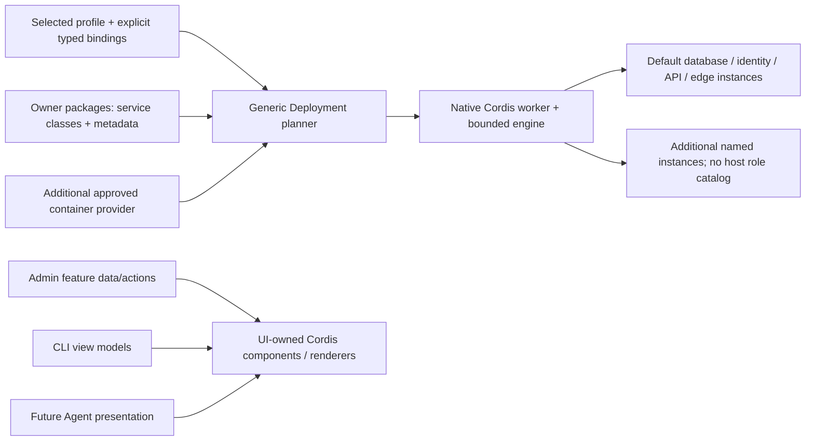

# Extensible container providers and required reusable UI

Date: 2026-10-24. Status: **proposed for maintainer review; documentation only**. Tracking: [Platform #722](https://github.com/treeseed-ai/platform/issues/722). This amendment extends the [composition/provider design](2026-10-24-cordis-composition-providers-design.md) before Task 3C. It does not start Task 3C/3D, initialize UI, change runtime contracts or authorize activation.

## Intent and evidence boundary

The maintainer requires extensible container plugins with typed providers and safe activation, and requires every human-facing interface to compose reusable presentation owned by the independent UI package. Native Cordis class plugins/providers are the default implementation of those presentation seams, not an optional future enhancement.

Task 3B is integrated at Platform `12ecb7c619cb1aee36de5250d11ab88428bf2fd0`; [its exact owner/artifact evidence](../../../composition/task3b.json) remains historical. Its implementation accepts exactly database/identity/api/edge in format 2, has fixed service/package/routing assumptions, and implements Admin HTML/browser and terminal rendering inside consumers. Those are current implementation facts to replace through owner PRs, not extensibility guarantees. UI is absent at `packages/ui`. Its existing canonical repository is `https://github.com/treeseed-ai/ui.git`; the observed original local source is `034b8811e42d7bededb8e2444ca4c099d79de4a3`. Re-fetch and pin live sources at future initialization; this observation is not an initialization baseline selection.

The design retains native Cordis as the sole service graph/lifecycle, exact prepared artifacts, one durable host authority and install-and-activate-when-safe. It removes the four-role limit from the next contract; the existing four services become one default composition profile.

## Decisions and ownership

| Owner | Required responsibility |
| --- | --- |
| SDK | Versioned executable service/binding/profile/probe/transition schemas; portable provider contracts; generation/lease mechanics; browser-safe composition entry separated from Node-only loading |
| Deployment | Generic artifact/source/build adapters, installed registry, single writer, transition planning, resource/credential receipts, container engine and default database/edge plugins; no service-role dispatch catalog |
| Identity | Identity container declaration, protocol configuration, principal/session providers and their compatibility/readiness behavior |
| API | API container declaration, host root, transport/operation adapters, runtime image/package bindings and target generation acknowledgement |
| UI | All reusable presentation contracts, components, styles, renderers, browser/server/terminal plugins and their contract/accessibility suites |
| Admin | Authorized feature contributions, view models/data adapters and action/session facade; composes UI exports without handwritten HTML/DOM/CSS/renderers |
| CLI | Arguments, command ownership, domain-to-view-model mapping and process streams/exit codes; human rendering consumes UI terminal providers; SDK machine JSON serialization remains CLI/SDK-owned |
| Platform | Default profile selections, exact artifact composition and assembled scenarios; no owner runtime, provider implementation or UI component source |
| Agent | Future execution root/providers and domain-to-view-model mapping; human presentation consumes UI; initialization/review gate still required at Task 3D |

Existing repositories, licenses and independent builds remain mandatory. UI reuse moves generic presentation to its already-established UI owner; it does not move Admin authentication, CLI command behavior or feature/domain authority into UI. A plugin package can export several services and UI contributions without acquiring another repository's capability. Test-only new container providers belong to Deployment fixtures, with genuine public archives consumed by Platform. Do not create a repository for each service or fixture. TreeDX remains its existing Elixir/Rust service; AI and speculative owners remain excluded.

## Service instances, typed bindings and profiles

The proposed format-3 installed composition contains a nonempty, bounded collection of `ServiceInstance` records, not a role enum or an exact service count. Service IDs use `[a-z][a-z0-9-]{0,47}`. The initial defensive ceiling is 256 services per composition; it is a resource limit, not a list of permitted roles. Profiles declare required bindings and approved policy requirements. The default Platform profile requires its database/identity/API/edge bindings but permits additional approved services; other reviewed profiles can use different capability graphs.

| Record | Required fields/meaning |
| --- | --- |
| `ServiceInstance` | `serviceId`, exact `provider` reference, validated `configuration`, `container` definition, provided `bindings`, required `dependencies`, selected `readiness`, declared `resources` and `transitionPolicy` |
| `ProviderRef` | Plugin/provider ID, target, package name/version/archive SHA-256, exact entry/class export and provider contract version |
| `ServiceBinding` | Unique `bindingId`, `contractId`, `contractVersion`, supplying service/provider identity; credentials/grants are separate references |
| `DependencyBinding` | Consumer `port`, exact `bindingId` and required contract/version; no first-match discovery or fallback |
| `ReadinessBinding` | Exact typed probe-provider reference, validated probe configuration, target service/endpoint references, deadline and required observation contract |
| `CompositionProfile` | Identity/version, required bindings and mandatory authority/network/management requirements; no executable code or embedded owner implementation |

Package metadata comes from the same owner declaration used by its native classes. It may declare multiple service instances/exports and supported typed contracts. Two instances of the same provider are valid when their IDs, bindings and resource scopes differ. A service may satisfy multiple explicitly declared bindings through its owner adapters; container readiness does not manufacture a database/cache protocol implementation.

For example, a default profile can add `echo-primary` and `echo-secondary`, each using the same fixture provider and distinct `diagnostic.primary`/`diagnostic.secondary` bindings. A consumer explicitly binds each input port. Neither `role === 'api'` dispatch nor assuming `database:5432` is valid in generic host code. Endpoint/configuration templates resolve declared `{serviceId, portId}` references. Identity/API/edge owners declare their protocol endpoints and routes; the host validates and renders accepted data.

SDK binding projections use native Cordis isolation and class-based bridge plugins to connect declared input ports to exact selected service addresses. The original provider's native `provide`/`inject` contract and the generated binding projection are both checked. Bindings remain Cordis services; no parallel instance map, resolver or scheduler is introduced. Registration supports alternatives; exactly one selected provider supplies each required binding in its scope. Collection bindings require an explicit typed collection contract. Duplicate IDs, ambiguous selection, incompatible contracts and dependency/probe cycles block before effects.

## Bounded container and readiness contracts

SDK proposes `ContainerEngine.start(serviceId, definition): Promise<void>`, `ready(serviceId): Promise<ServiceReadiness>` and `identity(serviceId): ServiceIdentity`. `ServiceIdentity` binds installation ID, service ID, selected provider and service generation. Owner container plugins expose the typed `ContainerService` contract (`identity`, `ready`) and inject this engine plus their explicit dependency ports. Engine instances are bound to the accepted application; a caller cannot submit arbitrary unplanned definitions or redirect authority by passing another service ID.

The positive `ContainerDefinition` includes one pinned native OCI image per service instance, bounded argv/non-secret environment, declared container ports, installation-owned named volumes, secret/config slots and declared network/publication requirements. Sidecars are additional explicit instances. Ordinary plugins receive no host shell, privileged mode, Docker socket, arbitrary host mounts, external volumes or broad network mutation hooks. The private worker socket mount is a narrowly typed API-host capability granted by the trusted profile, never an arbitrary path field. A supported new bounded effect requires an SDK schema, engine-policy qualification and tests, not permissive Compose passthrough.

Image descriptors bind selected index/manifest/config/layer digests and sizes, native architecture and exact package/asset associations where applicable. Service-to-image bindings are explicit and may safely share identical immutable images; no one-image-per-role assumption remains. Apply still performs no pull/build. Source/image acquisition and approved isolated builds finish before the exact local bundle is planned. OCI's [content descriptor specification](https://github.com/opencontainers/image-spec/blob/main/descriptor.md) defines digest/size identities; it does not establish publisher trust.

Readiness is a typed provider seam rather than a global enum of PostgreSQL/HTTP/HTTPS cases. Deployment owns generic bounded HTTP/TLS/connectivity probe adapters; service owners supply protocol-specific probe classes/contracts when required. Probes receive only accepted service endpoints, explicitly granted credential references, deadlines and cancellation. They do not receive arbitrary host commands or substitute TCP-open for a claimed application protocol guarantee. Same-process probe code is trusted executable code, qualified under the source policy; metadata/hashes are not a sandbox. Registering a new approved probe must require no role-specific branch in the engine. Direct service and routed operation/asset observations must agree before active/ready success. The qualified fifth-service scenario adds private, explicitly bound endpoints only: it verifies new direct protocol access and unchanged existing routed status/assets. Adding a public route changes the edge definition and is classified as edge reconfiguration, not an isolated addition. Task 3C returns prepared/action-required for that route change unless an explicitly qualified route-update provider proves safe admission, TLS retention and direct+routed read-back; current static edge configuration is not assumed live-updatable.

## Retained resources and safe activation

Separate installation-wide `compositionGeneration` from each `serviceGeneration` and each stable `resourceId`. Resource receipts bind installation, service, resource kind/ID, creating service generation, accepted definition/image and current referencing generations. A new composition can retain an unchanged service's old creating generation after verifying the receipt and live resource. Do not require every unchanged container's label to equal the newest overall plan digest. Names derive deterministically from installation/service/resource identity without lossy truncation; labels and receipts are checked before mutation.

Credentials/configuration use service-scoped slot identities. Unchanged compatible slots, data volumes and TLS authority retain their exact identities and bytes. Adding one service must not regenerate a shared password, replace the edge CA or restart every existing service. Cross-service secret references require explicit dependency/grant bindings. Templates cannot choose output paths or expose plaintext in plan/status/UI. The public artifact graph records references and digests, not secret values.

`DeploymentHost.plan(configuration)` remains non-activating. A format-3 plan includes the full selected graph plus a typed `ServiceChange[]`: `add`, `retain`, `replace`, `reconfigure` or `retire`, with affected dependencies, resource/credential retention, readiness requirements and required actions. Retire/removal intent is representable, but execution remains unsupported until Task 7 retention/removal proof; planning reports that blocker rather than ignoring the change. Mandatory bootstrap/auth/management bindings cannot disappear through a profile edit. Secret values are neither read nor generated during planning.

`PluginManager.install/select` uses this same plan/apply path. Source receipt/idempotency rules from the existing design remain: persist canonical intent before source/network/build actions; same key reuses exact accepted bytes and application; different intent conflicts. Before effects, the single writer reauthorizes source/resource grants, expected active composition, service generations, engine identity and current resources. Registration alone is not activation.

| Transition | Required outcome |
| --- | --- |
| Fresh installation or qualified additive service with isolated new resources | May activate automatically after exact validation/trust and readiness; retain every unaffected service/resource |
| Qualified same-process provider replacement | Close affected admission, drain pinned leases, use native lifecycle, verify dependent cleanup/readiness, commit/read back, reopen |
| Existing container replacement/reconfiguration requiring restart or unproven state compatibility | Retain candidate and exact plan; return `prepared`/required action. Explicit reviewed plan/apply authorization is needed for the restart scope |
| Data/schema, issuer/session or TLS-authority migration | Require a separately specified migration and explicit authorization; no implicit migration during install |
| Missing trust/build/selection, ambiguous bindings or stale generation | No activation; safe blockers/next actions, with exact durable request identity where established |
| Uncertain effects, cleanup failure, crash or partial cross-target publication | Fence affected admission; truthful `recovery-required` with actual observations; preserve unaffected services/data |

An advertised `live` policy is a claim, not proof. No two active writers for one resource, automatic lock stealing, forced drain timeout or blind old-image restart. Brief qualified unavailability may be explicit; general zero-downtime replacement is not promised. A bounded wait returns `pending`, never active. Each affected worker/API/browser/CLI target acknowledges its own accepted generation; no cross-process atomicity claim. Only `active`/`already-active` install results return exit 0; action-required/pending is 3, invalid input 2, unexpected runtime/I/O failure 1.

## Required reusable UI composition

Every human-facing surface uses `@treeseed-cordis/ui` public presentation contracts and class plugins: browser pages/navigation/forms/status, server-rendered HTML/error presentation, terminal help/tables/status/blockers and future Agent/public-reader views. Shared components are not reimplemented in Admin, CLI, API, Agent or Platform. Machine JSON/protocol schemas, HTTP authorization decisions, domain view-model preparation and process stream ownership stay with their current owners.

UI provides separate `./contracts`, `./browser`, `./server` and `./terminal` exports. Contracts/model data contain no DOM, Node filesystem or server credentials. Browser exports cannot import Node-only loaders, database clients, environment secrets or server modules; terminal/server consumers cannot pull in DOM side effects. First slice uses native Cordis and strict TypeScript class renderers with browser DOM adapters; adopting another rendering dependency later requires qualification and preserves this architecture. Do not copy legacy functional React/Astro implementations into the rewrite to evade class enforcement.

| UI contract/provider | Responsibility |
| --- | --- |
| `UiContribution` / `UiViewModel` | Validated contribution identity, component/provider binding, model schema reference, typed data, registered action IDs and asset identities; no raw executable callbacks or arbitrary HTML |
| `UiComponent` | Typed reusable rendering contract; default text, status, table, form, navigation and feedback components are providers, not a closed global component-kind enum |
| `UiServerRenderer.render(view)` | Escaped HTML plus exact asset references for Admin/API human pages; domain owners retain route/session/HTTP decisions |
| `UiTerminalRenderer.render(view)` | Human stdout/stderr presentation with deterministic plain/non-TTY behavior; CLI retains exit codes and machine envelope serialization |
| `UiBrowserRenderer.mount(target, view)` | Class-based DOM rendering with native effects, accessible semantics and awaited listener/subscription disposal |
| `UiActionDispatcher.invoke(actionId, input)` | Typed adapter supplied by the authorized feature host; UI does not perform privileged domain operations or acquire credentials |
| Theme, component and navigation contribution providers | Explicit typed selection/collection contracts; collisions and incompatible models fail before mount |

UI-owned `UiBrowserApplication` composes its native root through an SDK browser-safe composition export. SDK factors the existing shared native composition/lease mechanics into `./composition`; `./runtime` retains Node-only prepared-package loading. Deterministic browser generation hashing uses standard Web Crypto through async root construction, not a second DI runtime. The [Web Crypto digest operation](https://www.w3.org/TR/2017/REC-WebCryptoAPI-20170126/#SubtleCrypto-method-digest) is a feasibility reference; actual browser bundle/no-Node/default-root qualification is an implementation gate.

Admin supplies installation-status data/action contributions and composes UI-rendered pages; Identity retains OIDC/state/nonce/PKCE/principal/session custody; API retains HTTP/operation/worker authority. CLI supplies domain view models and consumes terminal providers even for noninteractive human output. Future UI contributions follow these public exports. This does not require a new context per button or data record.

Build browser contributions from exact accepted UI/domain archives. The plan and API image bind the complete asset generation and its dependency closure, including UI. Serve immutable digest-addressed assets under the existing same-origin/CSP boundary. Existing pages retain their accepted generation until a qualified page/session boundary; installation cannot claim an already-open browser has changed merely because server files changed. No arbitrary executable remote URLs, runtime eval or server credentials in browser bytes.

The existing Admin inline HTML/browser plugins and CLI human formatting are explicit Task 3C replacement work. Their current Task 3B behavior remains evidence only, not an exception allowing duplicated UI to grow.

## Compatibility and new-owner gates

Proposed first Task 3C contract pins: executable operation projection `0.5.0-cordis.1`, provider contract `0.4.0-cordis.1`, prepared-provider manifest format 2, installed release/plan/journal format 3. Keep the seven operation IDs. Browser becomes an explicit provider/contribution target in the new version; descriptor target identity never silently activates every target in a package. Owner package candidate versions/hashes are selected only after implementation and qualification.

Preserve format-1/2 schemas, saved bytes, plans, receipts, artifacts and source custody. Old readers reject format 3. A separately authorized explicit migration, under the same single writer and a non-serving target boundary, maps the four legacy service identities, live resources, existing private slot paths and TLS authority into format-3 receipts without changing those resources or replaying old plans. A fresh format-3 installation needs no migration. An active format-2 installation reports `MIGRATION_REQUIRED`; the installer must not perform a hidden migration or restart. Migration failure keeps evidence and requires explicit repair. Format-3 registry writes never append into a format-1/2 journal.

After plan approval and explicit Task 3C resumption, initialize only UI in its existing canonical repository using a fresh verified parent `origin/cordis`, preserved original source/history/license/base-owned policy files and the parent's initializer procedure. Stop for setup review before scaffolding, dependencies, tests/builds or implementation; publish its local baseline only on explicit instruction. This planning pass creates no UI checkout. At Task 3D perform the same separate Agent setup/review/publication gate; UI approval never approves Agent. Do not preinitialize other owners.

## Acceptance required before claiming extensibility

- A genuine owner-built container fixture adds a fifth service to the existing default profile through the built CLI install flow; no engine/worker role-specific code changes. Direct protocol/readiness, resource receipts and status confirm activation of private bound endpoints; existing public routes/assets remain unchanged. A new public route is an edge reconfiguration and must be action-required unless separately qualified. Existing container IDs, volume IDs, credentials and edge certificate fingerprint remain unchanged.
- Two instances of that provider have distinct typed bindings, resource/secret scopes and actual protocol observations; a consumer uses both correctly. Duplicate IDs, wrong contracts, absent/ambiguous bindings, cycles and cross-instance secret/resource attempts block before effects.
- A newly registered readiness provider performs a real protocol check, with no engine switch edit. A false-ready provider or wrong image/package/asset identity cannot produce active/ready success.
- Qualified provider swap drains real calls and fences old leases; stateful/restart/migration-required replacement remains action-required with the previous writer preserved. Stale generation, concurrent installs, lost replies and uncertain commit are exercised through real programs.
- Actual browser status/login/logout and plain/non-TTY terminal help/doctor/plan/apply output consume the same exact UI archive through UI-owned native providers. A UI-only candidate changes both assembled surfaces without copying renderers into consumers; machine JSON/exit contracts remain unchanged.
- UI source/asset boundary checks reject consumer-owned HTML/DOM/CSS rendering, function-based UI, Node/server modules in browser closure and plaintext/script canaries. Test escaped content, keyboard/focus/form behavior, generation mismatch and cleanup through actual browser/default roots.
- Historical Task 1–3B program/plan evidence stays valid. Formats 1/2 are not silently rewritten; migration and old-reader refusal are tested. All owner gates and exact assembled Ubuntu 26.04 CI pass; missing prerequisites fail visibly.

The [Task 3C implementation plan](../plans/2026-10-24-task3c-extensible-plugins-ui.md) assigns each proof to its owner. Full crash recovery remains Task 6 and disable/removal Task 7; those deficits produce explicit unsupported/action-required results in Task 3C. No production channels, legacy services or issues are closed by planning or integration.

## Fresh builder-check disposition

A fresh read-only builder identified one material ambiguity: whether the additive fifth-service proof also changes the public edge route. The design now specifies a private additive service, verification of existing routed surfaces, and explicit edge reconfiguration/authorization for new public routes unless a qualified route-update provider proves safety. This review resolves planning ambiguity; it is neither runtime evidence nor maintainer approval.
